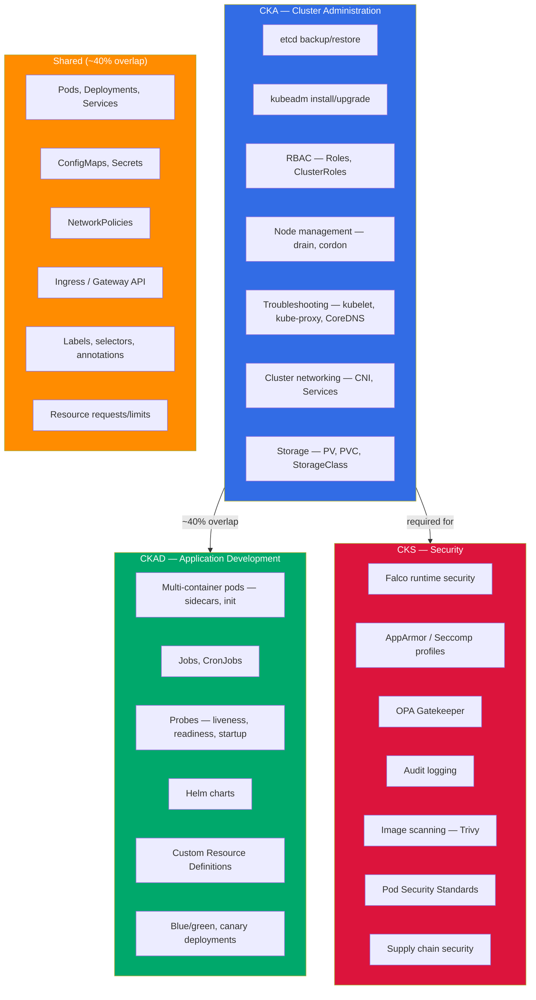

# Documentation

| | |
|---|---|
| [lab.md](lab.md) | The lab: clusters, practice sessions, mock exams, keys, writing an item |
| [templates.md](templates.md) | YAML templates for the common resources |
| [cks-wsl.md](cks-wsl.md) | Falco, AppArmor and gVisor for the CKS cluster on WSL2 |
| [cka/](cka/) | CKA guide |
| [ckad/](ckad/) | CKAD guide |
| [cks/](cks/) | CKS guide |

## CKA vs CKAD vs CKS

| | **CKA** | **CKAD** | **CKS** |
|---|---|---|---|
| **Focus** | Cluster administration | Application development | Security |
| **Who it's for** | SREs, platform engineers, admins | Developers deploying to K8s | Security engineers, senior admins |
| **Difficulty** | Hard — the troubleshooting and etcd questions are brutal under time pressure | Medium — if you already deploy to K8s, most of this is familiar | Hardest of the three — Falco and AppArmor syntax is miserable to memorize |
| **Duration** | 2 hours | 2 hours | 2 hours |
| **Passing Score** | 66% | 66% | 67% |
| **Cost** | $445 | $445 | $445 |
| **Prerequisites** | None | None | Must hold active CKA |
| **Key Topics** | etcd, kubeadm, RBAC, troubleshooting, networking | Pods, Deployments, Jobs, probes, volumes | Falco, AppArmor, OPA, Network Policies, audit |
| **Recommendation** | Start here if you manage clusters. The etcd and kubeadm skills don't exist anywhere else. | Easier than CKA but less impressive on a resume. | Take it if your job involves cluster security — it requires an active CKA. |

In short: if you're doing any kind of cluster administration, start with CKA. If you're purely a dev who deploys apps, CKAD first. CKS requires an active CKA, so you can't skip it. The lab covers all three from one pool of tasks.

There's about 40% overlap between CKA and CKAD (pods, deployments, services, configmaps, secrets). If you pass one, the other is easier. CKA first makes sense for most people, because troubleshooting and etcd backup are harder to learn on your own.

