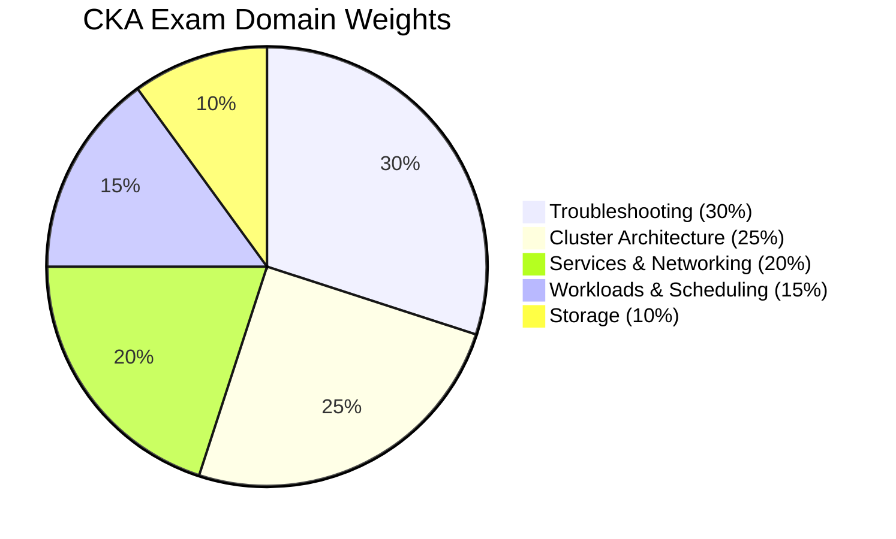

# CKA Guide

Study guide for the [Certified Kubernetes Administrator](https://www.cncf.io/certification/cka/). Practise the tasks in the lab (`./cka`, Studying for: CKA; see [docs/lab.md](../lab.md)).

| | |
|---|---|
| [exam-guide.md](exam-guide.md) | Before booking, the exam environment, time allocation, the costly mistakes, killer.sh, exam-day checklist, FAQ |
| [syllabus.md](syllabus.md) | The five domains with concepts, commands and manifests |
| [kubectl.md](kubectl.md) | Imperative commands by task, docs pages worth bookmarking, vim keys |
| [cheatsheet.md](cheatsheet.md) | One-page reference |
| [troubleshooting.md](troubleshooting.md) | Decision flowchart and symptom-based playbook |
| [diagnostics.md](diagnostics.md) | Decision trees per symptom |
| [study-plan.md](study-plan.md) | Resources, 4-5 week plan, progress tracker |
| [../templates.md](../templates.md) | YAML templates |

## Exam Details

**Version check (October 21, 2026):** The Linux Foundation lists Kubernetes v1.37 for the exam environments and says they generally move to a new minor version within about 4 to 8 weeks of its release. The lab targets v1.35 and is not all verified against v1.37. Check the [official FAQ](https://docs.linuxfoundation.org/tc-docs/certification/faq-cka-ckad-cks) and the [CKA curriculum](https://github.com/cncf/curriculum/blob/master/CKA_Curriculum_v1.37.pdf) before relying on version-specific details.

| **CKA Exam Details**               | **Information**                                                                                                                                     |
|------------------------------------|-----------------------------------------------------------------------------------------------------------------------------------------------------|
| **Exam Type**                      | Performance-based (live terminal — NOT multiple choice)                                                                                             |
| **Exam Duration**                  | 2 hours                                                                                                                                             |
| **Passing Score**                  | 66%                                                                                                                                                 |
| **Kubernetes Version**             | v1.37, according to the Linux Foundation FAQ checked October 21, 2026                                                                                |
| **Number of Questions**            | The official overview describes a performance-based exam; it does not give a fixed task count                                                       |
| **Exam Cost**                      | $445 USD (includes one free retake)                                                                                                                 |
| **Certificate Validity**           | 2 years                                                                                                                                             |
| **Exam Delivery**                  | PSI Secure Browser (remote proctored)                                                                                                               |
| **Allowed Resources**              | kubernetes.io/docs, kubernetes.io/blog, github.com/kubernetes — open in exam browser                                                                |
| **Domains Covered**               | 5 domains: Storage, Troubleshooting, Workloads & Scheduling, Cluster Architecture, Services & Networking                                            |
| **Exam Language**                  | English, Japanese, Simplified Chinese                                                                                                                |
| **OS in Exam**                     | Ubuntu Linux terminal                                                                                                                                |

Important: the passing score is 66%, not 75% like some older guides say. They lowered it. Still not easy though — 2 hours goes fast when you're troubleshooting a broken kubelet under pressure.

The Linux Foundation listed the exam-only option at **$445 USD** in October 2026. Bundles, retake eligibility, simulator access, and course access depend on the option shown at purchase and can change. Check the [official CKA page](https://training.linuxfoundation.org/certification/certified-kubernetes-administrator-cka/) for current details; promotions regularly lower the price.

## Domain Weights

Where to focus: Troubleshooting + Cluster Architecture = 55% of the exam. If you nail these two, you only need a few more points to pass.
