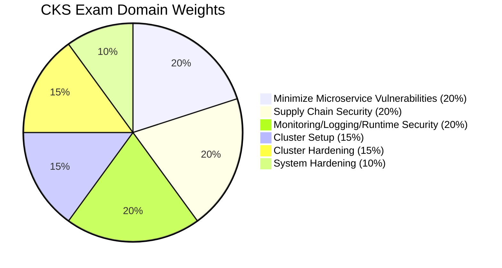

# CKS Guide

Study guide for the [Certified Kubernetes Security Specialist](https://www.cncf.io/certification/cks/). Practise the tasks in the lab (`./cka`, Studying for: CKS) on the `cks` cluster profile; see [docs/lab.md](../lab.md) and, on WSL2, [docs/cks-wsl.md](../cks-wsl.md).

The guide was imported from [theplatformlab/CKS-Certified-Kubernetes-Security-Specialist](https://github.com/theplatformlab/CKS-Certified-Kubernetes-Security-Specialist) (MIT) and written for Kubernetes v1.34. Check version-specific details against the [current curriculum](https://github.com/cncf/curriculum).

| | |
|---|---|
| [exam-guide.md](exam-guide.md) | Before booking, the exam environment, the first 60 seconds, time allocation, the costly mistakes, troubleshooting flowchart, killer.sh, exam-day checklist, FAQ |
| [syllabus.md](syllabus.md) | The six domains with concepts, commands and manifests |
| [kubectl.md](kubectl.md) | Security commands by task, docs pages worth bookmarking |
| [templates.md](templates.md) | Security YAML templates to write from memory |
| [study-plan.md](study-plan.md) | Resources, 4-5 week plan, progress tracker |

## Exam Details

| **CKS Exam Details**               | **Information**                                                                                                                        |
|------------------------------------|----------------------------------------------------------------------------------------------------------------------------------------|
| **Exam Type**                      | Performance-based (live terminal — NOT multiple choice)                                                                                 |
| **Exam Duration**                  | 2 hours                                                                                                                                |
| **Passing Score**                  | 67%                                                                                                                                    |
| **Kubernetes Version**             | This guide was written for v1.34 (March 2026); check the [official FAQ](https://docs.linuxfoundation.org/tc-docs/certification/faq-cka-ckad-cks) for the current version |
| **Number of Questions**            | ~15-20 tasks (varies per session)                                                                                                      |
| **Exam Cost**                      | $445 USD (includes one free retake)                                                                                                    |
| **Certificate Validity**           | 2 years                                                                                                                                |
| **Exam Delivery**                  | PSI Secure Browser (remote proctored)                                                                                                  |
| **Allowed Resources**              | kubernetes.io/docs, kubernetes.io/blog, github.com/kubernetes — open in exam browser                                                   |
| **Prerequisites**                  | Must hold an active CKA certification                                                                                                  |
| **Domains Covered**                | 6 domains: Cluster Setup, Cluster Hardening, System Hardening, Microservice Vulnerabilities, Supply Chain, Monitoring/Logging/Runtime   |
| **Exam Language**                  | English, Japanese, Simplified Chinese                                                                                                  |
| **OS in Exam**                     | Ubuntu Linux terminal                                                                                                                  |

Important: the passing score is 67%, not 75% like some older guides say. It's 1% higher than CKA (66%). Still not easy — the security-specific tooling (Falco, Trivy, AppArmor, audit policies) adds complexity you didn't see on the CKA.

## Cost

The CKS cost **$445 USD** in March 2026. What is included depends on the option shown at purchase; it has included:

- One exam attempt
- One free retake (if you fail)
- Two killer.sh simulator sessions (24 hours each)
- Access to a self-paced training course

Discount tips:
- The CNCF runs sales on Black Friday and KubeCon weeks — 30-40% off is common
- Linux Foundation bundles (CKA + CKS) sometimes drop to ~$600 total
- Check if your employer has a training budget — most do for certs
- Student discounts exist through the Linux Foundation

Don't pay full price if you can wait for a sale.

## Domain Weights

Where to focus: Microservice Vulnerabilities + Supply Chain + Monitoring/Logging = 60% of the exam. If you nail these three, you only need a few more points to pass.
