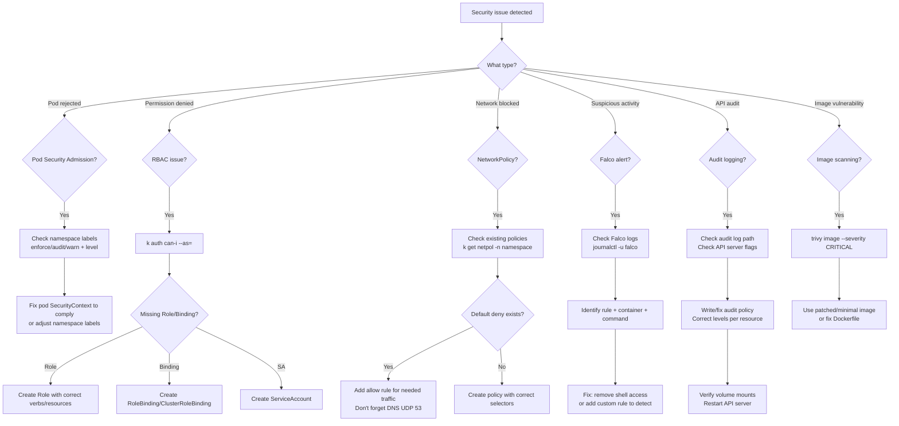

# CKS Exam Guide

What to know before booking and on exam day: the environment, the first minute in the terminal, time allocation, the mistakes that cost the most points, and how killer.sh compares. For the exam facts see the [CKS overview](README.md).

---

## Before You Book the CKS Exam

A checklist before you book:

1. **Do you have an active CKA?** CKS requires it. No exceptions. If your CKA expired, renew it first.
2. **Can you write a NetworkPolicy from scratch?** Default deny + targeted allow rules. Ingress AND egress.
3. **Can you configure an audit policy?** Levels (None, Metadata, Request, RequestResponse), API server flags, volume mounts.
4. **Have you used Falco?** Install it, trigger built-in rules, write a custom rule.
5. **Can you harden a pod's SecurityContext?** readOnlyRootFilesystem, runAsNonRoot, drop ALL capabilities, no privilege escalation.
6. **Do you know how to scan images with Trivy?** `trivy image <image>` — filter by severity, know what CRITICAL/HIGH means.
7. **Have you done killer.sh at least once?** The CKS killer.sh is harder than the real exam. If you pass it, you'll pass CKS.
8. **Is your ID ready?** Government-issued ID, matching your CNCF account name. Check this before exam day.

---

## The Exam Environment (PSI Remote Desktop)

The exam runs in a PSI Secure Browser — a remote Ubuntu desktop. Same as for the CKA. Things that surprise people:

**Copy/Paste:**
- `Ctrl+Shift+C` / `Ctrl+Shift+V` in the terminal
- Right-click paste works sometimes, sometimes it doesn't
- The built-in notepad uses normal `Ctrl+C` / `Ctrl+V`
- Practice these shortcuts. Fumbling with paste in the first question easily costs two minutes.

**Terminal quirks:**
- There's a small delay on every keystroke — maybe 50-100ms. It adds up.
- Tab completion works but feels laggy.
- You can open multiple terminal tabs. Two work well: one for the task, one for verification.
- The file browser is basic. Stick to command line.

**Browser:**
- One extra tab allowed for kubernetes.io documentation
- Bookmarks are not available — you'll type URLs manually
- The search on kubernetes.io is your best friend. Use it instead of navigating.

**General:**
- Webcam and mic are on the entire time
- Clear your desk — nothing on it except your computer
- No second monitor
- No headphones/earphones
- Water bottle is fine (clear, no label)
- Bathroom breaks are allowed but the timer doesn't pause

---

## First 60 Seconds — Aliases, vim, bash

Run this at the start of every exam session. It saves 10-15 minutes over 2 hours.

```bash
# Aliases
alias k='kubectl'
alias kn='kubectl config set-context --current --namespace'
alias kgp='kubectl get pods'
alias kgs='kubectl get svc'
alias kgn='kubectl get nodes'
alias kgnetpol='kubectl get networkpolicy'
alias kgsa='kubectl get serviceaccount'
alias kgsec='kubectl get secrets'
export do='--dry-run=client -o yaml'
export now='--force --grace-period=0'

# Tab completion
source <(kubectl completion bash)
complete -o default -F __start_kubectl k

# vim config
cat <<'EOF' >> ~/.vimrc
set expandtab
set tabstop=2
set shiftwidth=2
set number
set autoindent
EOF

# etcdctl
export ETCDCTL_API=3
```

For practice, [`scripts/exam-setup.sh`](../../scripts/exam-setup.sh) sets this up for you.

After setting up, verify:

```bash
k get nodes          # aliases work?
k run test --image=nginx $do   # $do works?
```

---

## Exam Day Strategy — Time Allocation

A two-pass approach makes a big difference.

**Pass 1 (first 80 minutes):** Do all questions in order. If a question looks like it'll take more than 8 minutes, flag it and move on. Don't get stuck.

**Pass 2 (last 40 minutes):** Go back to flagged questions. You now know how much time you have per question.

Time estimates by question type:

| Question Type | Typical Time | Notes |
|---|---|---|
| NetworkPolicy | 5-8 min | Default deny + allow rules, don't forget DNS egress |
| RBAC/ServiceAccount | 3-5 min | Know the imperative commands |
| Audit logging | 8-10 min | Write policy, update API server, mount volumes |
| Falco rule | 5-8 min | Read/modify rules, restart Falco |
| SecurityContext/Hardening | 3-5 min | Memorize the hardening pattern |
| Secrets + encryption at rest | 8-10 min | EncryptionConfiguration, API server restart |
| Pod Security Admission | 3-5 min | Namespace labels |
| Image scanning (Trivy) | 3-5 min | trivy image command |
| AppArmor/Seccomp | 5-8 min | Check profile exists, apply to pod |
| Ingress TLS | 4-6 min | Create TLS secret, configure Ingress |
| CIS benchmark (kube-bench) | 5-8 min | Run kube-bench, fix findings |

Total available: 120 minutes. Budget ~100 minutes for questions, 20 minutes buffer for context switching, copy/paste fumbling, and double-checking.

---

## Mistakes That Will Fail You on the CKS

These are the mistakes that cost the most points in practice.

### 1. Forgetting to switch context

Every question says "use context k8s-xxx." If you forget, you're working on the wrong cluster and get zero points.

```bash
# ALWAYS do this first
k config use-context <context-name>
```

### 2. Wrong namespace

You create resources in `default` when the question says `production`. Zero points.

```bash
# Set namespace for the question
kn <namespace>
# Or use -n on every command
k get pods -n production
```

### 3. NetworkPolicy without DNS egress

You write a NetworkPolicy egress rule but forget to allow DNS (UDP 53). The pod can't resolve service names, nothing works, and you think the policy is wrong.

```yaml
# Always include this in egress rules
- to: []
  ports:
  - protocol: UDP
    port: 53
```

### 4. AppArmor — using annotations instead of the field

Since v1.30, AppArmor is GA and uses `securityContext.appArmorProfile`. The old annotation (`container.apparmor.security.beta.kubernetes.io/<name>`) still works but might not be what the exam expects.

```yaml
# Correct (GA — v1.34)
securityContext:
  appArmorProfile:
    type: Localhost
    localhostProfile: my-profile

# Old annotation (deprecated)
# container.apparmor.security.beta.kubernetes.io/app: localhost/my-profile
```

### 5. Audit logging — forgetting volume mounts

You add audit flags to kube-apiserver but forget the volume mounts. The API server can't read the policy file or write logs.

```yaml
# Must mount BOTH:
# 1. The audit policy file directory
# 2. The audit log output directory
```

### 6. Not verifying your work

You think you're done, move to the next question, and lose points because something isn't actually working. Always verify:

```bash
k get pod <name> -n <ns>              # Is it Running?
k get networkpolicy -n <ns>           # Does policy exist?
k auth can-i list pods -n <ns> --as=system:serviceaccount:<ns>:<sa>  # RBAC working?
k get ns <ns> --show-labels           # PSA labels applied?
```

### 7. Secrets — base64 encoding mistakes

You put plaintext in the `data` field instead of base64-encoded values. Or you use `stringData` when the question expects `data`. Know the difference:

```yaml
# data — values must be base64-encoded
data:
  password: czNjcmV0     # echo -n 's3cret' | base64

# stringData — values are plaintext (converted to base64 automatically)
stringData:
  password: s3cret
```

### 8. Wasting time on hard questions first

A 3-point question and a 7-point question get the same time if you're stuck. Do the easy ones first.

### 9. EncryptionConfiguration — wrong provider order

The first provider is used for encryption. If you put `identity: {}` first, secrets are stored unencrypted. Always put the encryption provider first:

```yaml
providers:
- aescbc:        # First = used for encryption
    keys:
    - name: key1
      secret: <key>
- identity: {}   # Last = fallback for decryption only
```

---

## Security Troubleshooting Flowchart

Use this when a security-related question feels unclear.



---

## killer.sh vs the Real CKS Exam

How killer.sh compares with the real exam:

| | **killer.sh** | **Real CKS Exam** |
|---|---|---|
| **Difficulty** | Harder — deliberately over-tests | Moderate |
| **Number of questions** | ~20-25 | ~15-20 |
| **Time pressure** | Very tight — most people don't finish | Tight but doable |
| **Question length** | Some are multi-step and long | More focused, shorter |
| **Scoring** | Shows score after 24h session | Shows score in 24h via email |
| **Environment** | Same PSI-like terminal | PSI Secure Browser |
| **kubectl access** | Same as real exam | Same |
| **Docs access** | kubernetes.io | kubernetes.io |
| **Falco/Trivy** | Pre-installed | Pre-installed |

A low first killer.sh score is normal.

If you score 55%+ on killer.sh, you'll likely pass the real exam. The real exam is more straightforward — fewer trick questions, shorter multi-step problems. CKS killer.sh is notoriously harder than the actual exam.

---

## CKS Exam Day Checklist

### 1 Week Before

- [ ] Schedule the exam — pick a time when you're alert
- [ ] Verify your CNCF account name matches your government ID exactly
- [ ] Do killer.sh session 2
- [ ] Review weak domains one more time
- [ ] Test your webcam and microphone

### 1 Day Before

- [ ] Clear your desk — nothing on it except your computer, keyboard, mouse
- [ ] Remove any papers, books, or second monitors
- [ ] Test your internet connection (wired is better than WiFi)
- [ ] Review the [first 60 seconds setup](#first-60-seconds--aliases-vim-bash)
- [ ] Review the [exam day strategy](#exam-day-strategy--time-allocation)
- [ ] Get a good night's sleep

### 30 Minutes Before

- [ ] Close all apps except the PSI browser
- [ ] Go to the bathroom
- [ ] Have water ready (clear bottle, no label)
- [ ] Start the PSI check-in process (it takes 10-15 minutes)
- [ ] Show the proctor your room and desk

### During the Exam

- [ ] Run the setup script / type aliases first thing
- [ ] Switch context before every question
- [ ] Read each question fully before starting
- [ ] Flag hard questions, come back later
- [ ] Verify your work: `k get`, `k describe`, `k auth can-i`
- [ ] Don't panic if kubectl hangs after an API server restart — wait 30-60 seconds

---

## CKS Exam FAQ — Frequently Asked Questions 2026

### Is the CKS exam hard?

It's the hardest of the three Kubernetes certs. The passing score is 67%, and the security-specific tooling (Falco, Trivy, AppArmor, audit policies) adds complexity beyond what CKA tests. If you passed CKA recently, you already know 30% of the material. The other 70% is security-specific and requires dedicated practice.

### Is the CKS worth it in 2026?

If you work with Kubernetes in any security-sensitive role: yes. It forces you to learn runtime security, supply chain hardening, and admission control — topics that most people skip. It also signals to employers that you care about more than just deploying apps.

### How long should I study for the CKS?

Depends on when you passed CKA:
- **Just passed CKA (< 1 month ago)**: 3-4 weeks
- **CKA was a while ago**: 4-5 weeks (need to refresh RBAC, NetworkPolicy)
- **CKA knowledge is rusty**: 6-8 weeks (review CKA material + CKS prep)

### Do I need any prerequisites for the CKS?

Yes — you must hold an **active CKA certification**. If your CKA has expired, you need to renew or retake it before you can register for CKS. This is strictly enforced.

### What if I fail the CKS?

You get one free retake included with your $445 purchase. You can schedule the retake anytime within your 12-month eligibility window. CKS has a higher fail rate than CKA — don't be discouraged if you need the retake.

### Is the CKS exam open book?

Same as CKA — you can access kubernetes.io/docs, kubernetes.io/blog, and github.com/kubernetes in the exam browser. You cannot access Falco docs, Trivy docs, Stack Overflow, or any other external site. Use `--help` in the terminal for tool-specific help.

### Can I take the CKS remotely?

Yes — the CKS is remote-only via PSI Secure Browser. Same setup as CKA: quiet, private room with webcam and microphone. A proctor monitors you the entire time.

### How is the CKS different from CKA?

CKA covers cluster administration (setup, upgrade, troubleshooting, RBAC). CKS covers cluster security (Falco, AppArmor, Seccomp, OPA, audit logging, supply chain, image scanning). CKA is a prerequisite for CKS. There's about 30% overlap (RBAC, NetworkPolicy, SecurityContext).

### How many questions are on the CKS?

Approximately 15-20 tasks. The exact number varies per exam session. Each task has a weight (percentage) that tells you how much it's worth. CKS typically has fewer questions than CKA but they're more complex.

### What Kubernetes version is on the CKS in 2026?

v1.34 as of March 2026. The exam updates to match recent stable releases. Check the CNCF handbook for the current version before your exam.

### Can I use aliases and scripts during the CKS?

Yes. Same as CKA — you can set up any aliases, bash functions, or vim config you want at the start of the exam. The exam environment gives you a fresh terminal.

### How fast do I get my CKS results?

Results come via email within 24 hours. Mine arrived in about 14 hours. You'll get a score and pass/fail. If you pass, the certificate PDF is available in your CNCF portal.

### Is CKS harder than CKA?

Yes. CKS builds on CKA knowledge and adds an entirely new layer of security tooling (Falco, Trivy, AppArmor, Seccomp, audit policies, OPA). Most people who passed CKA comfortably say CKS was noticeably harder. The pass rate is lower, and the time pressure is tighter because security tasks involve more steps.

### What tools are pre-installed on the CKS exam?

The exam environment has `kubectl`, `jq`, `tmux`, `curl`, `vim`/`nano`, and the standard Linux utilities. Security-specific tools like **Falco** and **Trivy** are pre-installed on the relevant nodes. You don't need to install anything — but you need to know how to use them.

### Can I copy-paste YAML during the CKS exam?

Yes — from the kubernetes.io docs into the exam terminal. You can also copy from the exam question into the terminal. Ctrl+Shift+C / Ctrl+Shift+V works in the PSI terminal. Practice this workflow before exam day.

### How do I renew my CKS certification?

CKS certification is valid for **2 years** (changed from 3 years). You can renew by retaking the exam or completing a renewal assessment through the CNCF portal before expiration.

### What is the CKS exam passing score?

The CKS passing score is **67%** (as of 2026). This is slightly higher than CKA's 66%. Each task has a weight — partial credit is possible on some tasks. Focus on the high-weight questions first.

### Is Falco on the CKS exam?

Yes. Falco is a key topic under Domain 6 (Monitoring, Logging and Runtime Security — 20%). You need to know how to read Falco rules, identify alerts, and write custom rules. Falco is pre-installed in the exam environment.
